<p align="center">
  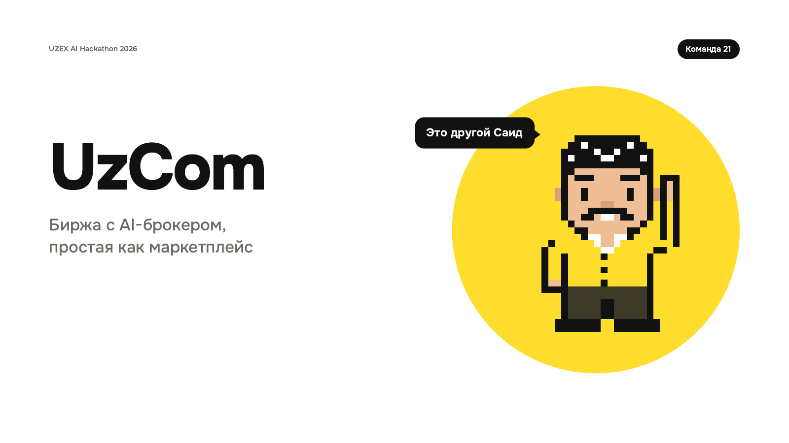
</p>

# UzCom

**Buy on the commodity exchange the way you buy in an online shop.** No broker, no terminal, no paperwork: see the
price delivered to your door, pay, and follow the truck on a map. The money stays on the exchange until the cargo
arrives.

Built by Team 21 for the final of the UZEX AI Hackathon 2026, task "The Exchange of 2035 — Reinvent UZEX". It runs as
a Telegram Mini App in [@uzex21_bot](https://t.me/uzex21_bot) and as an iPhone app (Expo). The screens are in Russian.

## The app

| | | |
|:---:|:---:|:---:|
| 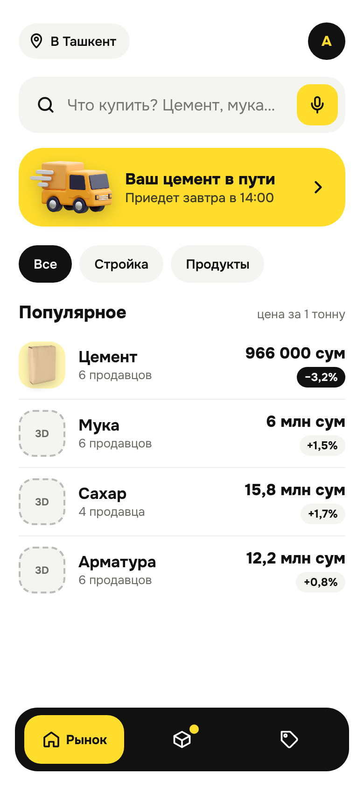 | 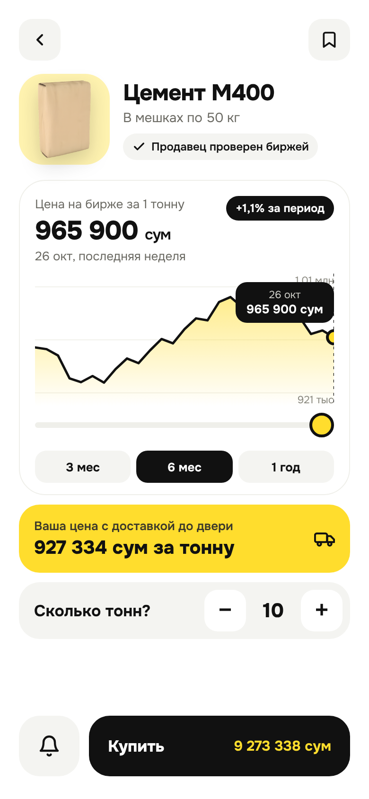 | 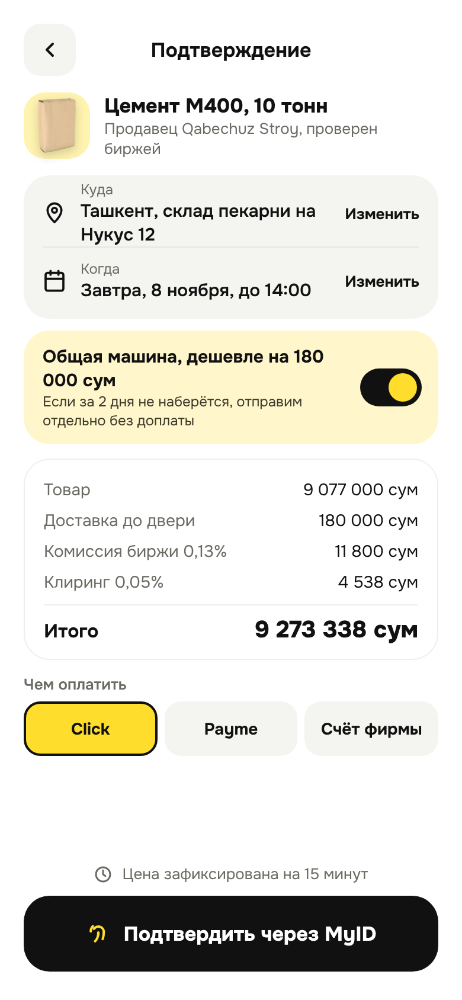 |
| **Рынок**<br>Search, the order on its way, prices per tonne | **Цемент М400**<br>Exchange price chart and the price at your door | **Подтверждение**<br>Shared truck, every fee, Click, Payme, MyID |
| 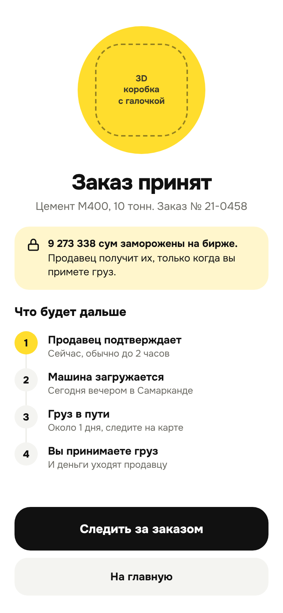 | 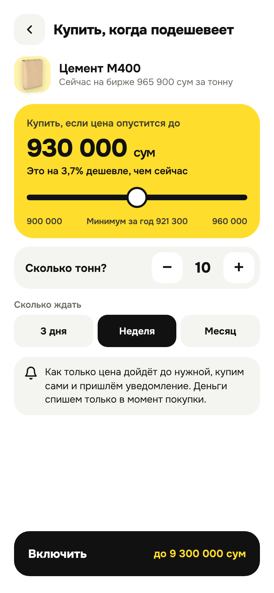 | 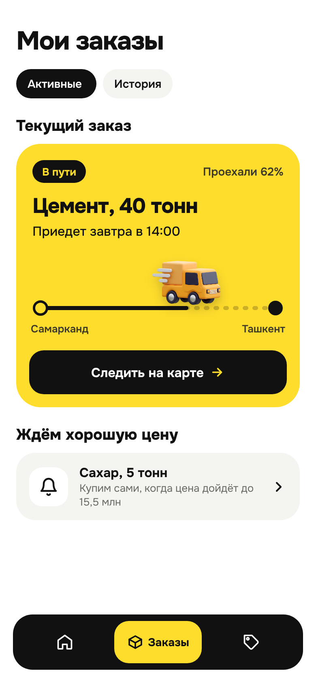 |
| **Заказ принят**<br>Money frozen on the exchange, the next steps | **Купить, когда подешевеет**<br>Target price and wait time; the app buys by itself | **Мои заказы**<br>What is on the way and what price we wait for |
| 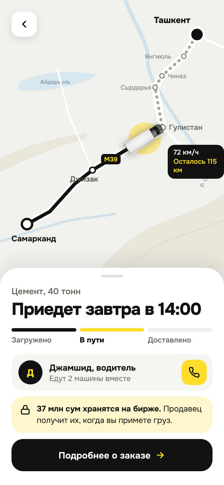 | 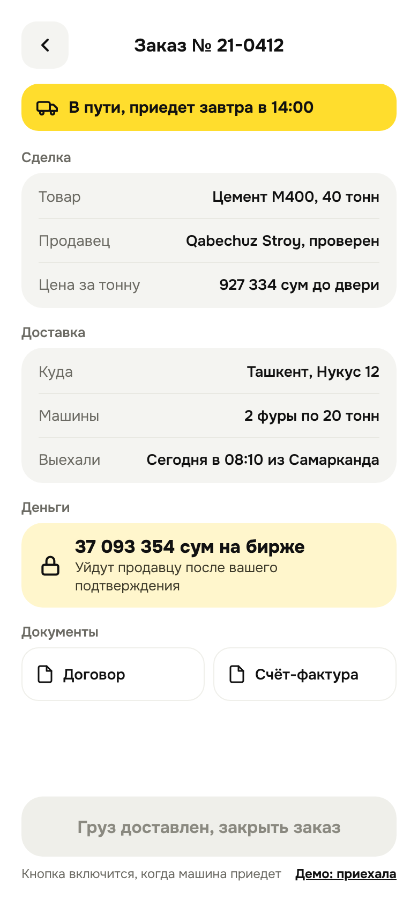 | 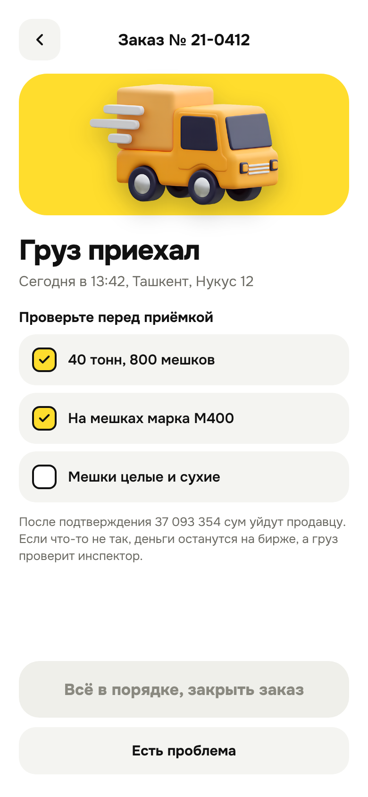 |
| **В пути**<br>The truck on route M39, the driver, money held | **Заказ № 21-0412**<br>Deal, delivery, money and documents | **Груз приехал**<br>Check the cargo, close the order, rate the seller |

## AI broker

<table>
  <tr>
    <td width="50%" align="center">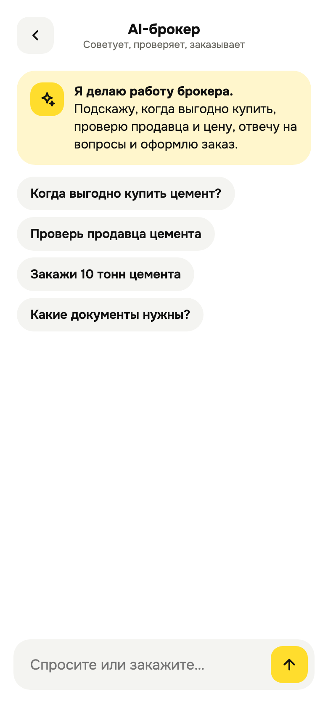</td>
    <td width="50%" align="center">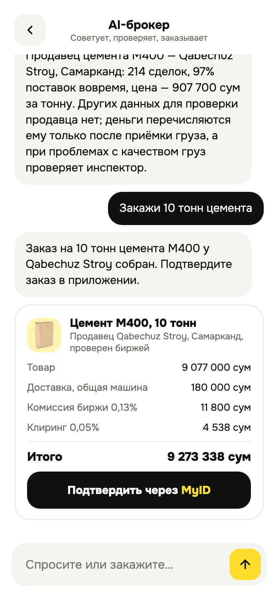</td>
  </tr>
</table>

The AI broker does the job a human broker does today, in a chat, in Russian or Uzbek:

- **Advises** when it is a good time to buy, from the price, the monthly change and the year low.
- **Answers** questions about fees, documents, delivery and how the money is held.
- **Checks** a seller's deals and on-time deliveries, and the price against the exchange average.
- **Orders**: "Закажи 10 тонн цемента" gives an order card to confirm with MyID.

The model only writes the reply and picks the good and the tonnes. The server prices every order, and the buyer
confirms it. If the model is unavailable, simple rules answer, so the app never stops. The AI broker lives on the
`ai-broker` branch, which is what the bot runs today.

## How the numbers work

- **Price at the door** = seller price + delivery + exchange fee 0.13% + clearing 0.05%. 10 t of cement M400 comes to
  9 273 338 so'm.
- **Shared truck**: delivery costs half. If the truck does not fill in 2 days, it leaves anyway at no extra cost.
- **Safe money**: the payment is frozen on the exchange and goes to the seller only after the buyer accepts the cargo.

This is a demo, not a working product: prices, sellers and orders are fixed demo values.

## Run

```bash
uv sync
uv run uvicorn uzcom.app:app --app-dir src --port 8035
```

Open http://localhost:8035/ in a phone-sized window. Add a screen name to open it directly, for example
http://localhost:8035/#Y4Track.

```bash
uv run pytest
```

## Team 21

- **Saidgani Dadajanov**: backend
- **Timur Djalilov**: design
- **Sevinch Kurbonova**: finance

## More

- [How it works](docs/how-it-works.md)
- [Demo script and jury questions](docs/demo.md)
- [Hosting, Telegram and iPhone](docs/deploy.md)
